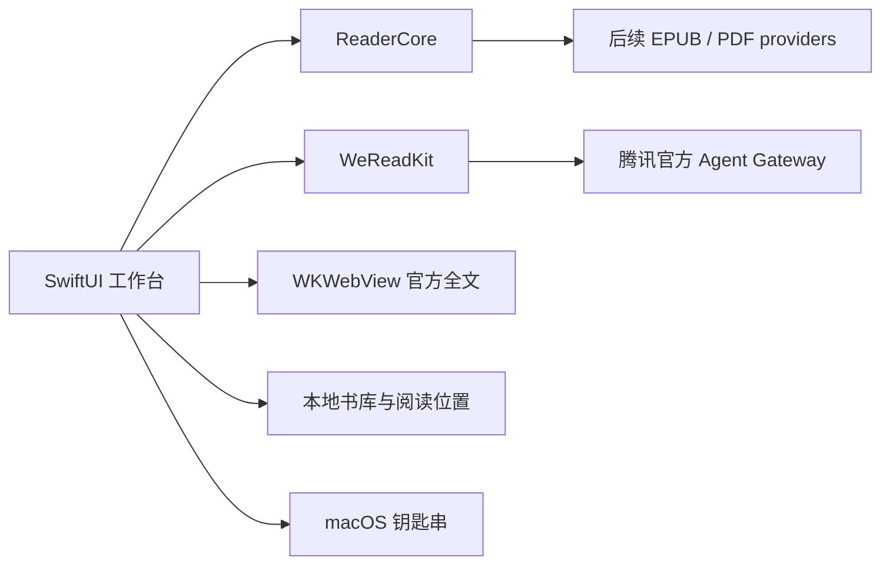

# MaBooks

一个以 SwiftUI 构建的 macOS 阅读工作台。将微信读书电子书架、热门划线和段落想法放在原生窗口里，全文通过内嵌官方网页版阅读。

**当前阶段：0.2 皮肤与阅读工作台。** 已实现官方 Gateway 适配与离线示例；尚未使用真实账号完成接口和扫码登录验收。这是独立开源项目，与腾讯无隶属关系。

## 已有功能

| 功能 | 当前实现 |
| --- | --- |
| 原生阅读 | 原创示例书、UTF-8 TXT 导入（10 MB 以内）、本地保存 |
| 皮肤切换 | 春日樱语、海盐微风、林间书屋、素纸；自动保存、可关闭装饰 |
| 显示主题 | 明亮、纸张、夜间、跟随系统 |
| 阅读布局 | 连续滚动、每页四段的分组翻页、隐藏书架的专注模式 |
| 阅读位置 | 点击段落或切换分组翻页后自动保存；再次打开书籍恢复 |
| 微信读书书架 | 官方 API Key 连接，手动同步电子书条目 |
| 段落想法 | 从热门划线选择原文，按 bookId / chapterUid / range 查询、翻页 |
| 微信读书全文 | WKWebView 内嵌官网，独立扫码登录；默认浏览器备用入口 |
| 账号存储 | API Key 保存在 macOS 钥匙串；网页会话由 WebKit 保存 |

原生的主题、字号和布局控制适用于本地书及划线列表。微信读书网页全文使用网站自身的阅读设置。热门划线接口最多返回 20 条，不代表全书正文或全部划线。书架当前仅显示电子书，不包括有声书与文章收藏。

点击正文顶部或书架底部的画板图标可切换皮肤。默认采用原创樱花窗边插画、暖白面板、粉色段落高亮和三栏阅读布局，设计说明与素材提示词见 [皮肤模块](docs/SKINS.md)。

## 运行

要求 macOS 14+、Swift 6.0+（测试使用 Swift Testing）。安装 Xcode 或 Apple Command Line Tools：

```sh
xcode-select --install
git clone https://github.com/marioMLLL/MaBooks.git
cd MaBooks
swift run MaBooks
```

在 Xcode 中打开 `Package.swift`，选择 `MaBooks` scheme 和 My Mac 也可运行。

构建本地应用：

```sh
bash scripts/package-app.sh
open dist/MaBooks.app
```

脚本生成本机架构的 `.app` 并进行 ad-hoc 签名。它不是经过 Apple 公证的发行版，不会自动安装到 Applications。GitHub Actions 提供构建 ZIP 作为 CI artifact；正式签名、公证及 Universal Binary 是后续工作。

## 连接微信读书

1. 打开应用右上角“账号”，前往 [微信读书官方 API Key 页面](https://weread.qq.com/r/weread-skills)。
2. 在应用 SecureField 中粘贴自己的 `wrk-…` Key，点击“保存并同步”。请勿把 Key 写进代码、Issue 或提交记录。
3. 从“微信读书 · 电子书”选择一本书，读取热门划线；点击原文，在侧边栏查看该位置的真实想法。
4. 点击“阅读全文”进入官方网页版，按网站流程登录。API Key 和网页扫码登录相互独立。
5. 账号设置中可以分别断开 API 和退出网页账号。

实现依据腾讯公开文档（检查日期：2026-10-12）：

- [官方 Gateway 入口与请求规范](https://github.com/Tencent/WeChatReading/blob/main/skills/SKILL.md)
- [电子书架](https://github.com/Tencent/WeChatReading/blob/main/skills/shelf.md)
- [热门划线与划线下的想法](https://github.com/Tencent/WeChatReading/blob/main/skills/notes.md)

当前请求版本为 `1.0.5`。参数放在顶层；如果服务端返回 `upgrade_info`，应用会停止解析并要求更新。书籍阅读链接直接使用官方返回的 `readerLink`，不会自行拼接 ID。应用不下载微信读书全书、不读取其他浏览器 Cookie，也不访问移动 App 私有接口。

## 项目结构

```text
Sources/
  ReaderCore/       # Book / Paragraph / opaque anchor、TXT、示例内容
  WeReadKit/        # 官方 Gateway 网络请求和领域模型适配
  MaBooks/        # SwiftUI、账号钥匙串、书库持久化、WebKit
Tests/
  ReaderCoreTests/  # 本地文本、模型持久化和 URL 校验
  WeReadKitTests/   # URLProtocol fixtures、定位、分页、错误和升级
openspec/changes/bootstrap-macos-reader/
                    # proposal / design / specs / tasks
docs/               # 架构、验收与迭代路线
packaging/          # .app 元数据
scripts/            # 打包脚本
.github/workflows/  # macOS 编译、测试、打包
```



## 验证与迭代

```sh
bash scripts/test.sh
swift build -c release
openspec validate bootstrap-macos-reader --strict
```

Fixtures 是依据官方字段编写的合成数据，不是已验证的真实账号回包。实际账号兼容性需按 [验收清单](docs/ACCEPTANCE.md) 确认。后续优先完成真实账号联调、EPUB/PDF 导入、字体感知分页和全文中的原生评论联动，见 [迭代路线](docs/ROADMAP.md)。

为兼容旧版，内部应用标识与数据目录仍保留原值；现有书库和设置可继续读取。本地书库位于 `~/Library/Application Support/WeReadMac/local-library.json`；偏好与段落位置存于 UserDefaults。当前不会在磁盘缓存微信读书书架或评论。

## License

项目原创代码使用 [MIT](LICENSE) 许可证。书籍正文、读者想法和平台内容的权利仍归各自权利人。原创示例仅用于演示。
