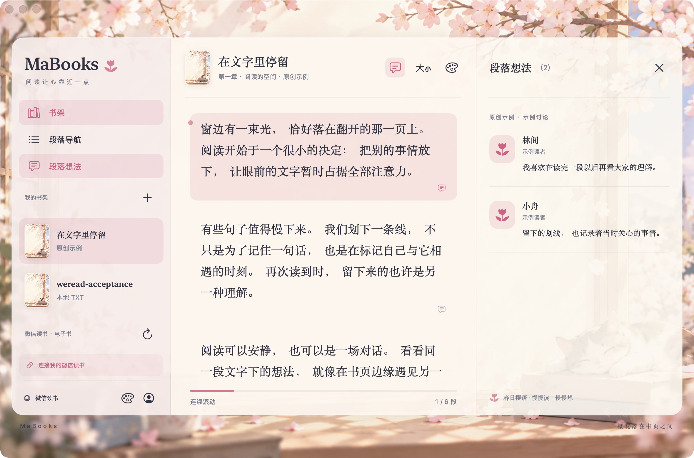

# MaBooks 📚🐾


**给文字一张舒服的桌子，给你一个多读两页的理由。**

MaBooks 是一款 SwiftUI 原生 macOS 阅读软件：读本地 TXT，把微信读书的电子书架、热门划线和段落想法搬到桌面，再给阅读换一套喜欢的皮肤。猫咪负责可爱，翻页还得靠你。

**macOS 14+ · 四套皮肤 · 段落想法 · MIT 开源**



*实机截图，展示项目原创示例书与示例讨论。图里的猫已经躺好了，你也可以开始读了。*

[快速上手](#start) · [功能清单](#features) · [换个皮肤](#skins) · [微信读书](#weread) · [安装运行](#install) · [开发与路线图](#development)

<a id="start"></a>
## 🚀 打开以后，先做这三件事

1. **读两段。** 点击书架中的《在文字里停留》，直接体验内置示例，无需连接账号。
2. **聊一句。** 点击正文段落或旁边的评论气泡，右侧会展开对应的想法。示例书展示示例讨论，微信读书划线展示接口返回的真实想法。
3. **换个心情。** 点击正文顶部或书架底部的**画板图标**，选一套皮肤。先换三遍再读书，也算熟悉软件了。🎨

想读自己的书？点击“我的书架”右侧的 **＋**，或按 **⌘O** 导入 UTF-8 TXT。当前支持 **100 MB（100 MiB）以内**的文件，导入后保存在本机，默认按书页阅读。点击底部上一页／下一页或书页左右边缘，也可用 **← / →、Page Up / Page Down、空格（下一页）／Shift+空格（上一页）** 翻页。窗口和字号变化后会重新分页，并保持原阅读位置；重启后重新选书也能继续。

书读完了想整理书架？打开本地书后点击正文顶部的**垃圾桶**，或右键书籍选择**“移到最近删除”**。点“我的书架”右侧的垃圾桶打开**“最近删除”**，可恢复书籍及阅读位置。删除只整理 MaBooks 的书库，不会动你导入前的原始 TXT。猫可以把书推下桌，但你还能捡回来。🐾

大文件首次导入、保存或重新分页需要一些时间，界面会显示进度状态；同一时间只处理一项书库写入。

<a id="features"></a>
## ✨ 功能清单：猫很忙，软件也没闲着

| 功能 | 怎么用 / 能做什么 |
| --- | --- |
| 📖 本地阅读 | 内置原创示例书；通过 ＋ 或 ⌘O 导入最多 100 MB 的 UTF-8 TXT，后台导入与保存，重启后书库仍在 |
| 🗑️ 删除与恢复 | 打开本地书后点击顶部垃圾桶，或右键书籍“移到最近删除”；在“我的书架”旁的垃圾桶中恢复 |
| 🎨 四套皮肤 | 春日樱语、海盐微风、林间书屋、素纸；点击画板切换，选择自动保存 |
| 🌗 四种阅读主题 | 明亮、纸张、夜间、跟随系统；与皮肤独立设置 |
| 🧘 三种阅读布局 | 点击翻页（默认）、连续滚动、专注阅读；本地书按窗口和字号分页，长段落可跨页，专注模式隐藏书架 |
| 🔠 字号与段落导航 | 在“阅读设置”中调节字号；左侧“段落导航”可跳到指定段落或热门划线 |
| 📍 阅读位置 | 点击段落或切换分组页后保存位置，再次打开该书时恢复 |
| 🔗 微信读书电子书架 | 保存官方 API Key 后同步电子书条目，点击同步图标可再次刷新 |
| 💬 划线下的想法 | 选书 → 热门划线 → 点击原文；右侧查看该位置的想法，有更多时可继续加载 |
| 🌐 微信读书全文 | 点击“官方网页阅读”的地球图标，进入内嵌官方网页版；也可用默认浏览器打开 |
| 🔐 账号存储 | API Key 放进 macOS 钥匙串；网页会话由 WebKit 保存，二者可分别断开 |

### 常用快捷键，少找几次按钮

| 快捷键 | 操作 |
| --- | --- |
| `⌘O` | 导入 TXT |
| `⌘,` | 账号设置 |
| `⌘⇧I` | 显示 / 隐藏段落想法 |
| `⌘⇧W` | 打开微信读书网页版 |

<a id="skins"></a>
## 🎨 换肤：今天的书，穿什么？

点击正文顶部或书架底部的 **画板图标 → 选择皮肤**，立即生效，自动保存。书架、正文、评论面板和段落高亮一起换色，阅读位置、字号和布局继续留在原处。

| 皮肤 | 阅读氛围 |
| --- | --- |
| 🌸 **春日樱语** | 默认皮肤。樱花窗边、奶油色书页、粉色高亮；猫咪已经替你占好座位 |
| 🌊 **海盐微风** | 清爽蓝色与柔和曲线，给桌面吹点海风，暂时不用买机票 |
| 🌿 **林间书屋** | 温柔绿意，适合把一段文字读得慢一点 |
| 📄 **素纸** | 简洁配色与安静书页，适合今天只想跟文字待一会儿 |

<p align="center">
  
</p>

**皮肤和阅读主题各管一摊。** 喜欢樱花，也可以搭配夜间主题；想让页面更安静，可以关闭“显示皮肤装饰”，保留配色和封面缩略图。


*同一套樱花皮肤的夜间主题。猫没有下班，书页已经关灯。🌙*

字号与显示方式在正文顶部的**阅读设置（字号图标）**里调整。以上设置用于本地书和原生划线列表；微信读书网页全文使用网页内的阅读设置。

<a id="weread"></a>
## 💬 接上微信读书，让划线旁边热闹一点

### 连接书架与段落想法

1. 点击书架底部的**人形账号图标**，或按 **⌘,** 打开账号设置。
2. 前往 [微信读书官方 API Key 页面](https://weread.qq.com/r/weread-skills)，登录并获取自己的 `wrk-…` Key。
3. 将 Key 粘贴到应用里的密码输入框，点击 **“保存并同步”**。
4. 在“微信读书 · 书架与划线”区域选择一本书，应用内直接打开官方阅读器，并尝试通过书籍详情刷新官方阅读链接。
5. 首次需要在网页中扫码登录。要查看原生划线，点击阅读器上方 **“划线与想法”**，再选一条原文；出现 **“加载更多”** 时可继续翻阅。

### 微信读书正文为什么走网页？

点击阅读区顶部的**“官方网页阅读”地球图标**，或从书架底部打开“微信读书”，再按官网提示登录。网页与 API 各自登录：连接 API 后，网页仍可能需要登录；账号设置里也有独立的“断开 API 连接”和“退出网页账号”按钮。

如果书架直链打不开，点击阅读器上方的 **“查找电子书”** 或 **“查找网文小说”**，应用会查询官方书城并显示候选。核对书名、作者、出版信息后点 **“打开此版本”**，使用该候选的官方阅读链接。不同版本的正文、划线和进度可能不同，因此不会自动替你选择同名书。

网页登录与 API Key 独立；登录后可点 **“重新打开此书”** 回到当前书籍。书架记录没有可用链接、网页拒绝该书或查询失败时会给出对应提示。书籍权限与可读章节仍由官方阅读器判定。

想放大阅读窗口，又舍不得漂亮皮肤？点击 **“全屏阅读”**，或按 **⌃⌘F**。全屏保留当前皮肤、装饰、书架和圆角阅读卡片，与本地文档使用同一套外框；工具栏的 **“退出全屏”** 或同一快捷键可返回。全屏切换沿用当前网页，不重新登录、不跳回首页。网页正文的字体、单双页与配色可在微信读书自己的阅读设置中调整。📖

书架挡住你的阅读气场了？点 **MaBooks 标题右侧的侧边栏图标**收起它，阅读区会变宽。想找下一本书，再点阅读区左上角的同一图标展开；也可按 **⌘⌥S**。本地阅读、微信读书和全屏均支持，并记住你的选择。进入原生专注模式时侧栏仍会隐藏，点击展开会回到翻页模式。🐾

**同步书架 ≠ 下载整本书。** 当前官方公开 Gateway 提供书架、目录、划线和想法及阅读链接，没有整本正文下载接口。本机保存的是你导入的 TXT；微信读书书架与热门划线通过官方接口读取，正文由官方网页显示。本地翻页功能不会把微信读书全文自动变成离线书。

API Key 请留在应用和钥匙串里。它不用参加 Git 提交，也不用到公开 Issue 里交朋友。🔑

### 当前版本能读到哪里？

当前公开安装版为 **0.2.4**；阅读器与书城候选恢复流程正在 **0.2.5** 分支验证。官方 Gateway 的书架、热门划线和评论适配已实现，真实账号回包与网页登录联调仍按 [验收清单](docs/ACCEPTANCE.md) 推进。

- 原生微信读书内容区展示**热门划线摘录**，接口最多返回 20 条；全文通过官方网页版阅读。
- 出现“暂无热门划线”时，点击页面中的**“官方网页阅读”**继续阅读。划线列表为空也可以读书，猫不会拦着你。🐾
- 微信读书书架目前显示**电子书**；有声书和文章收藏暂未接入。
- 本地格式目前支持 **TXT**；EPUB、PDF 和双页阅读在 [迭代路线](docs/ROADMAP.md) 中。
- 本地 TXT 没有社区评论；内置示例的讨论会明确标为“示例”。

MaBooks 是独立开源项目，与腾讯无隶属关系。在线能力使用腾讯公开的官方 Gateway，不下载微信读书全书，也不读取其他浏览器的 Cookie。

<a id="install"></a>
## 🍎 安装运行：让猫搬进你的 Mac

### 下载最新版安装包

前往 [最新 Release](https://github.com/marioMLLL/MaBooks/releases/latest)，在 **Assets** 中下载 `MaBooks-版本号-macOS-arm64.dmg`，打开后将 MaBooks 拖入 Applications；也可下载 ZIP，解压得到 `MaBooks.app`。更新前先退出旧版，再打开新安装的应用。🐾

### 使用 GitHub 测试构建

前往 [Actions](https://github.com/marioMLLL/MaBooks/actions/workflows/macos.yml)，打开一次成功的 `macOS` 构建，在 **Artifacts** 中下载 `MaBooks-arm64`。解压下载包中的 `MaBooks.zip`，即可得到 `MaBooks.app`。

当前 Release 和 CI 附件面向 Apple Silicon Mac；Intel Mac 可以在本机从源码构建。构建产物采用本地 ad-hoc 签名，尚未经过 Apple 公证，正式签名发行版仍在后续计划中。

### 从源码运行

需要 **macOS 14+、Swift 6.0+**，安装 Xcode 或 Apple Command Line Tools 即可。

```sh
# 已安装 Xcode / Command Line Tools 可跳过这一行
xcode-select --install

git clone https://github.com/marioMLLL/MaBooks.git
cd MaBooks
swift run MaBooks
```

也可以在 Xcode 中打开 `Package.swift`，选择 `MaBooks` scheme 和 `My Mac` 后运行。

要生成自己的应用包：

```sh
bash scripts/package-app.sh
open dist/MaBooks.app
```

生成的应用位于 `dist/MaBooks.app`，包含皮肤素材和猫咪图标，可自行放入 Applications。

<a id="development"></a>
## 🛠️ 开发与路线图：这只猫还在长本事

后续优先完成真实账号联调，再增加 EPUB / PDF、本地高亮与笔记、双页阅读和正式签名分发。具体任务见 [ROADMAP](docs/ROADMAP.md)。欢迎围绕使用体验、界面或格式支持提交 [Issue](https://github.com/marioMLLL/MaBooks/issues)。

<details>
<summary>给准备撸起袖子的开发者：结构、检查和接口文档</summary>

```text
Sources/ReaderCore/   # 书籍、段落定位、TXT、皮肤标识
Sources/WeReadKit/    # 官方 Gateway 与响应适配
Sources/ReaderLayoutKit/ # 原生排版与书页布局
Sources/MaBooks/      # SwiftUI、皮肤、钥匙串、本地书库、WebKit
Tests/               # 阅读模型与 Gateway 合成回包测试
openspec/changes/    # 每次迭代的提案、设计、规格与任务
docs/                # 设计、验收和路线图
packaging/           # 应用元数据
scripts/             # 测试、图标转换与应用打包
```

```sh
bash scripts/test.sh
bash scripts/package-app.sh
openspec validate mabooks-skins --strict
```

接口依据腾讯公开文档：[调用规范](https://github.com/Tencent/WeChatReading/blob/main/skills/SKILL.md)、[书架](https://github.com/Tencent/WeChatReading/blob/main/skills/shelf.md)、[划线与想法](https://github.com/Tencent/WeChatReading/blob/main/skills/notes.md)。当前请求版本为 `1.0.5`，服务端要求升级时应用会提示更新。

更多细节：[皮肤模块](docs/SKINS.md) · [图标制作](docs/ICON.md) · [实机验收](docs/ACCEPTANCE.md)。自动测试使用合成数据；真实账号兼容性按验收清单单独确认。

为兼容旧版，本地书库仍位于 `~/Library/Application Support/WeReadMac/local-library.json`，内部 bundle identifier 与 Keychain service 保持原值。偏好和段落位置存于 UserDefaults；当前不在磁盘缓存微信读书书架或评论。0.2.4 保存书库时会升级为包含最近删除的快照格式，旧版应用无法读取这个新格式。

</details>

## 📜 License

原创代码使用 [MIT](LICENSE) 许可证。书籍正文、读者想法和平台内容的权利归各自权利人。

书可以慢慢读，猫可以继续睡。欢迎给 MaBooks 一颗 Star，让它醒来时发现自己有点受欢迎。⭐
