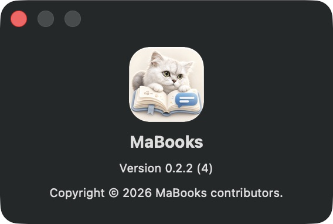

# MaBooks 图标

当前使用用户更新的图标：睁着绿色眼睛的奶油色猫咪、打开的书和蓝色评论气泡。源文件为 `Sources/MaBooks/Resources/AppIcon.png`，README 和应用打包共用这一个文件。

采用 GitHub 提交 `576524c` 中的最新裁剪图标，保留原图细节、奶油色圆角底板和透明四角。此次同步不重新绘制，旧版图标的抠图记录不再描述当前素材。

## 更新方式

替换源 PNG 后运行 `bash scripts/package-app.sh`。其中 `scripts/make-icon.sh` 使用 macOS 原生工具生成 16、32、128、256、512 像素以及对应 @2x 尺寸，转换为 `dist/MaBooks.icns`。

应用包包含两份用途不同的资源：

- `Contents/Resources/MaBooks-<图标内容摘要>.icns`：Info.plist 的 `CFBundleIconFile` 指向此文件，用于系统应用图标。内容变化时文件名同步变化，避免系统复用旧图标缓存。
- `Contents/Resources/MaBooks_MaBooks.bundle/AppIcon.png`：SwiftPM 资源，与仓库源 PNG 保持一致。

启动时显式设置 `applicationIconImage`，“关于 MaBooks”面板也显式使用同一份资源，避免默认关于面板显示系统缓存的旧图标。打包运行时按 Info.plist 加载 ICNS，源码运行时加载 PNG。更新后退出已运行的 MaBooks，再打开新的应用包，避免进程继续显示启动时加载的旧图标。

本次图标更新版本为 **0.2.2（4）**，可通过“MaBooks → 关于 MaBooks”确认打开的是新版应用。

2026-10-12 验证：打包后的 PNG 与仓库源文件一致；14 项回归测试、release 打包和签名校验通过。重新启动应用后，实际关于面板显示睁眼猫咪及版本 0.2.2（4），深色背景下没有外围白色方块。

